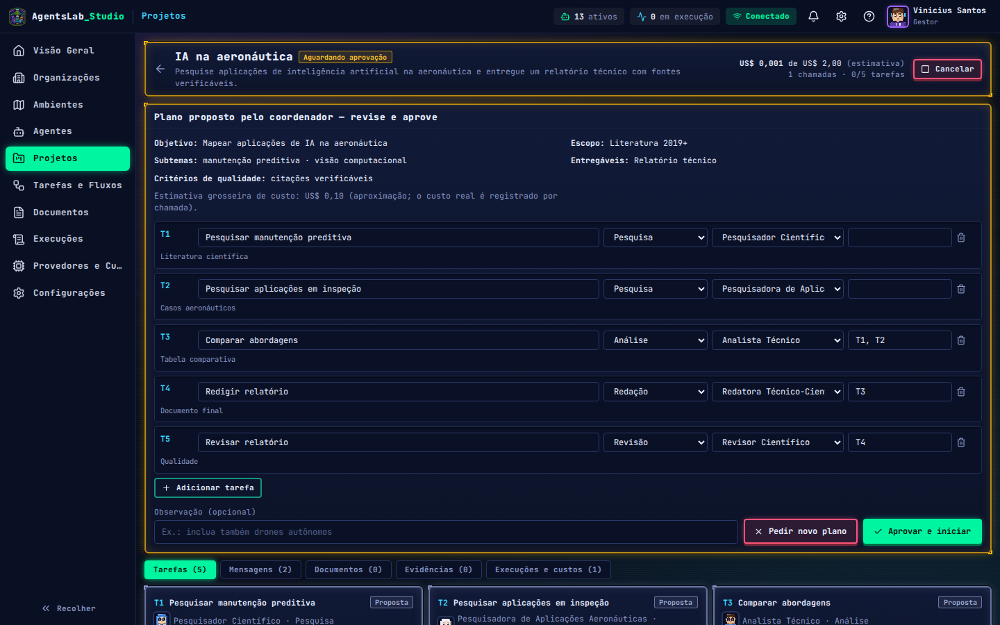
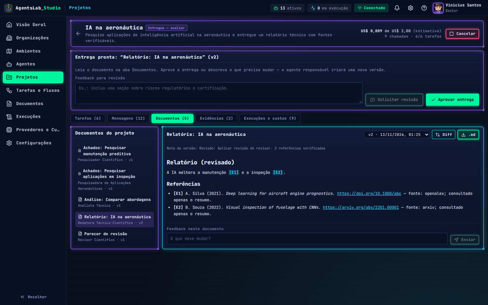
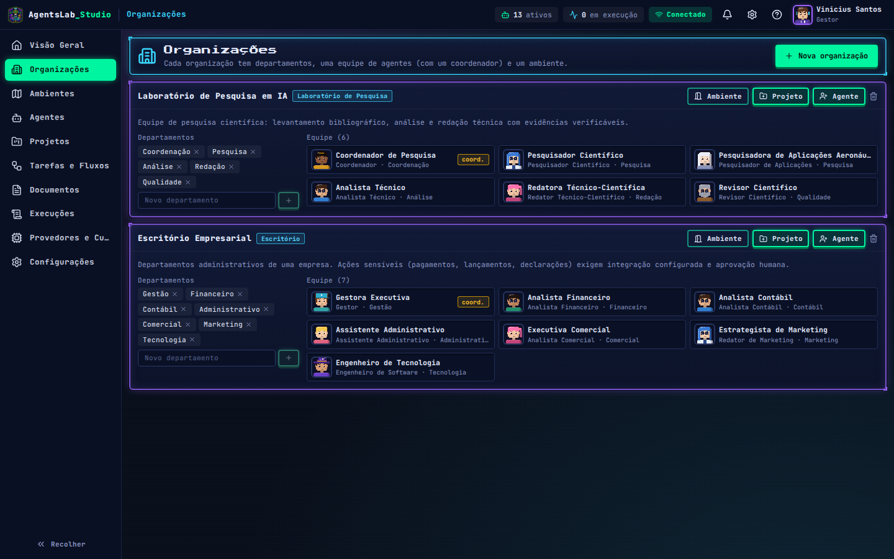
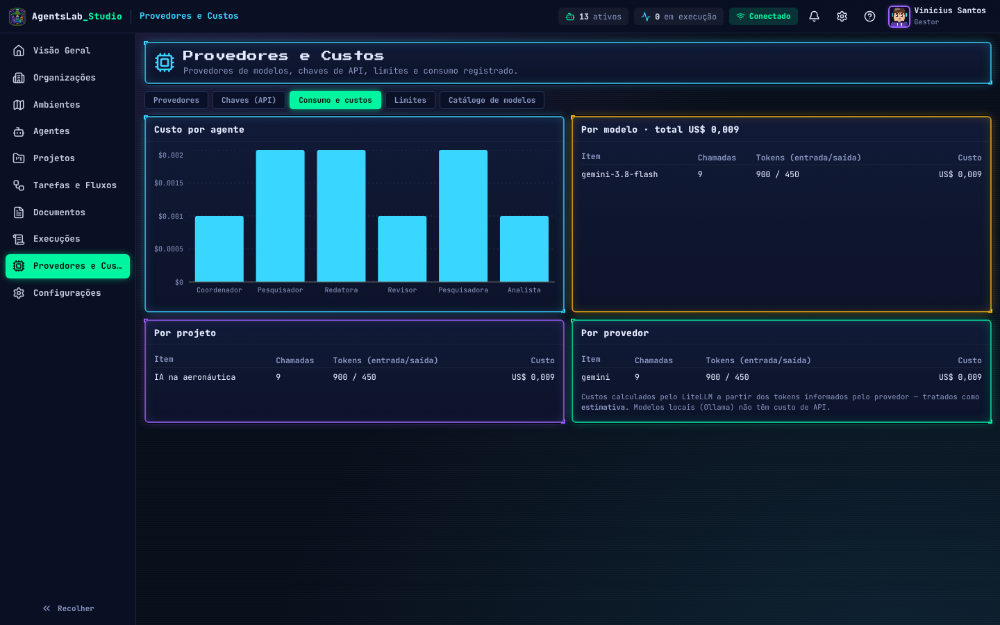
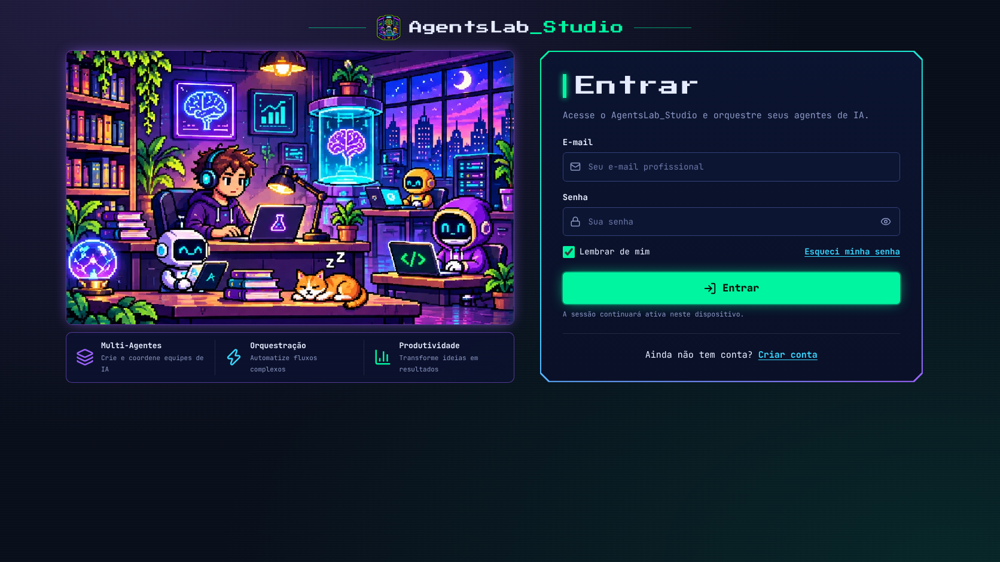
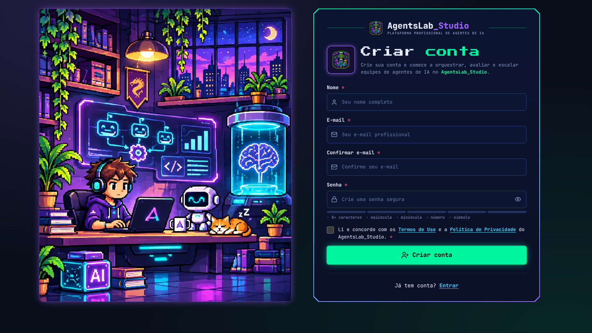
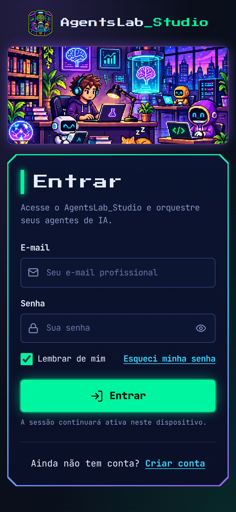

# AgentsLab_Studio

**Plataforma de organizações multiagentes com visual pixel art.** Você descreve um trabalho em linguagem natural; o agente coordenador da organização propõe um plano; você aprova ou ajusta; os agentes executam tarefas reais (chamadas a LLMs e a ferramentas de pesquisa), trocam entregas, consolidam um documento, revisam e produzem versões a partir do seu feedback. O escritório e o laboratório em pixel art mostram esse trabalho acontecendo: estados, mensagens e entregas dos personagens vêm do backend.


| Plano proposto pelo coordenador | Entrega versionada com referências |
|---|---|
|  |  |
|  |  |

> As capturas acima são geradas automaticamente com a API em **modo de teste** (respostas determinísticas, sem LLM real) para não depender de chaves no CI. Com suas chaves, o mesmo fluxo usa os modelos reais.

## v1.3 — contas, publicação e celular

- **Login e cadastro reais com Supabase Auth** (telas pixel art dos protótipos): e-mail + senha, mostrar/ocultar senha, “lembrar de mim”, verificação de e-mail obrigatória, recuperação e redefinição de senha, links expirados tratados, logout e rotas protegidas. Senhas e tokens ficam com o Supabase — o app nunca os armazena.
- **Multiusuário isolado:** o backend valida o JWT do Supabase em cada requisição; organizações, agentes, projetos, chaves, preferências e eventos são de cada usuário (RLS no banco como defesa extra).
- **Reanalisar projeto:** refaz o plano — opcionalmente trocando provedor/modelo de toda a equipe (ex.: quando o Google descontinua um modelo). **Repetir falhas** reexecuta só as tarefas que falharam.
- **Provedores com rascunho + Salvar:** ativar/desativar e modelo padrão só valem após salvar e persistem; **Atualizar lista de modelos** consulta a API do provedor com a sua chave; ids de modelo personalizados.
- **Publicação:** frontend na Vercel/Cloudflare Pages, backend em container (Dockerfile) e Supabase PostgreSQL — ver [docs/DEPLOY.md](docs/DEPLOY.md) e [docs/SUPABASE.md](docs/SUPABASE.md).
- **Responsivo:** menu em gaveta no celular, painéis em tela cheia, login/cadastro adaptados.

| Login | Cadastro | Celular |
|---|---|---|
|  |  |  |

## v1.2 — o que mudou

- **Sem gamificação:** XP, níveis, missões-RPG, recompensas, créditos e conquistas foram removidos. O estilo pixel art permanece.
- **Organizações e departamentos** (Laboratório de Pesquisa em IA, Escritório Empresarial; modelo Fábrica de Software), cada uma com coordenador e equipe.
- **Projetos por prompt** com aprovação humana do plano, execução com dependências, mensagens estruturadas (solicitação, entrega, revisão, orientação, feedback…), consolidação, revisão e **documentos versionados com diff**.
- **Evidências rastreáveis:** fontes reais do OpenAlex e arXiv (DOI/URL), marcação “apenas resumo”, referências geradas pelo sistema (o modelo não escreve a lista) e detecção de citações inexistentes.
- **Custos e limites:** cada chamada é registrada (tokens, latência, custo estimado pelo LiteLLM) por agente, projeto, modelo e provedor; orçamento por projeto pausa a execução.
- **Mundo conectado ao backend:** estados reais, balões com mensagens reais e entregas (o agente caminha até o colega). A ambientação (café, conversas sociais) nunca afirma progresso de trabalho.
- **Chaves digitadas no app → cofre do sistema operacional** (Windows: Gerenciador de Credenciais).

## Chaves de API

1. Inicie o backend (abaixo) — o app mostra **Conectado** na barra superior.
2. **Provedores e Custos → Chaves (API) → Novo perfil**: provedor, apelido e a chave.
3. **Agent Studio → Inteligência → Chave de API**: escolha o perfil de cada agente (ou deixe o padrão do provedor, marcado com ★).

A chave sai do navegador uma única vez para o backend, que a guarda **criptografada (Fernet) no PostgreSQL** com a `AGENTSLAB_MASTER_KEY` — que existe só nas variáveis do servidor. A API nunca devolve a chave; o navegador só vê apelido e os 4 últimos dígitos. No app desktop sem servidor, o cofre pode ser o **Gerenciador de Credenciais do Windows** (`AGENTSLAB_SECRET_BACKEND=keyring`).

**Microsoft Store (planejado):** empacotar com Tauri 2 (frontend) + backend Python como *sidecar* (PyInstaller) em MSIX — o mesmo modelo de chaves no cofre do Windows. Detalhes em [docs/PLANO_ADAPTACAO.md](docs/PLANO_ADAPTACAO.md).

## Como executar (Windows / PowerShell)

O banco é **PostgreSQL** (SQLite e Turso não são usados — só nos testes automatizados). O caminho mais simples é usar o **Supabase**, que já fornece o banco e o login: crie o projeto seguindo [docs/SUPABASE.md](docs/SUPABASE.md). Alternativa local: `docker compose up -d db` (Docker Desktop).

**1. Backend** — crie `apps/api/.env` a partir do `.env.example`:

```powershell
cd C:\dev\AgentsLab_Studio\apps\api
copy .env.example .env
python -c "from cryptography.fernet import Fernet; print(Fernet.generate_key().decode())"   # cole em AGENTSLAB_MASTER_KEY
# edite .env: AGENTSLAB_DATABASE_URL (Supabase → Connect → Session pooler) e AGENTSLAB_SUPABASE_URL
python -m venv .venv; .venv\Scripts\activate
pip install -r requirements.txt
uvicorn app.main:app --port 8000
```

**2. Frontend** — `apps/web/.env` com `VITE_SUPABASE_URL` e `VITE_SUPABASE_PUBLISHABLE_KEY` (chave **publicável**):

```powershell
cd C:\dev\AgentsLab_Studio\apps\web
npm install
npm run dev          # http://localhost:5173
```

**3. Conta principal** (uma vez) — cria sua conta já confirmada como dona da plataforma e, se quiser, traz os dados do modo local:

```powershell
cd C:\dev\AgentsLab_Studio\apps\api
$env:SUPABASE_URL="https://<ref>.supabase.co"
$env:SUPABASE_SERVICE_ROLE_KEY="<secret key do painel — nunca no frontend>"
python scripts\criar_conta_principal.py --nome "Seu Nome" --email voce@exemplo.com --assumir-dados-locais
```

A senha é digitada no terminal (não fica em arquivo nem no histórico). Depois, troque-a quando quiser em **Configurações → Conta → Trocar senha**.

**4. Chave do Gemini** — em **Provedores e Custos → Chaves**, cadastre a chave: o app testa cada modelo da sua conta Google e mostra **só os que funcionam**, escolhendo um padrão automaticamente. Projetos que falharam por modelo descontinuado: abra o projeto → **Reanalisar**.

### Primeiro projeto (teste obrigatório)

**Projetos → Novo projeto →** “Usar exemplo: pesquisa sobre IA na aeronáutica” → organização *Laboratório de Pesquisa em IA* → **Enviar ao coordenador** → revise/ajuste o plano → **Aprovar e iniciar**. Acompanhe no Laboratório ou na aba Tarefas; ao final, leia o relatório (aba Documentos), confira as evidências, envie feedback e compare as versões (Diff).

## Testes

| Comando | O que valida |
|---|---|
| `cd apps/api; pytest` | 22 testes (também passam sobre PostgreSQL com `AGENTSLAB_TEST_DATABASE_URL`): fluxo completo da aeronáutica (plano → edição → aprovação → dependências → evidências → consolidação → revisão automática → feedback → v3 + diff → aprovação → custos), JWT do Supabase e isolamento entre usuários, lista de modelos Gemini testados (descarta descontinuados), conta principal, banco obrigatório, reanálise com troca de modelo, provedor desativado, cofre multi-chave, orçamento, cancelamento, chat, tarefa avulsa, CRUD |
| `cd apps/web; npm test` | Vitest: A\*, motor ambiental (entregas reais, ambientação sem falso progresso), eventos SSE → estados, stores, UI |
| `npm run e2e` | Playwright (17): troca de senha, cadastro → verificação → login → sessão → recuperação de senha → logout contra um Supabase Auth falso local; projeto completo; reanalisar; salvar provedores; celular |
| `npm run media` | gera prints, MP4 e GIF em `docs/media` |

Os testes usam LLM, ferramentas e Supabase Auth **de teste** (`apps/api/tests/fakes.py`, `fake_supabase.py`), carregados somente nos testes.

## Publicar no GitHub

```powershell
cd C:\dev\AgentsLab_Studio
powershell -ExecutionPolicy Bypass -File .\scripts\publicar-github.ps1 -Mensagem "feat: plataforma de organizações multiagentes"
```

| Workflow | Quando | Resultado |
|---|---|---|
| **CI** | push/PR | build, Vitest, E2E (com API de teste) e pytest |
| **Showcase** | push na `main` ou manual | prints, vídeo e GIF commitados em `docs/media` |
| **Release** | tag `v*` | zip do frontend + tarball da API |

## Estrutura

```
apps/api/app
  models.py              organizações, departamentos, agentes, projetos, tarefas, mensagens, artefatos+versões, evidências, execuções, aprovações, eventos
  services/orchestrator  planejamento → aprovação → execução com dependências → consolidação → revisão → feedback
  services/llm.py        LiteLLM (Gemini, Groq, OpenAI, Hugging Face, Ollama), custo por chamada
  services/tools.py      OpenAlex + arXiv (fontes reais)
  services/vault.py      cofre do SO (keyring) / Fernet
  services/events.py     eventos persistidos + SSE com replay
  routers/               credentials, organizations (+agents/chat/tarefas), projects, system (SSE, provedores, uso, visão geral)
apps/web/src
  features/projects      projetos e espaço de trabalho (plano, tarefas, mensagens, documentos, evidências, custos)
  features/organizations, documents, analytics (execuções), models (provedores e custos), agents (Agent Studio)
  world/                 mundo pixel art (A*, AmbientWorld, Phaser) alimentado por services/realtime.ts (SSE)
tools/pixelart           gerador procedural de sprites e mapas
```

Documentação: [Supabase](docs/SUPABASE.md) · [Publicação](docs/DEPLOY.md) · [Plano de adaptação](docs/PLANO_ADAPTACAO.md) · [Arquitetura](docs/ARCHITECTURE.md) · [Roadmap](docs/ROADMAP.md) · [Design System](docs/DESIGN_SYSTEM.md) · [Agentes](docs/AGENT_MODEL.md) · [CLAUDE.md](CLAUDE.md)
