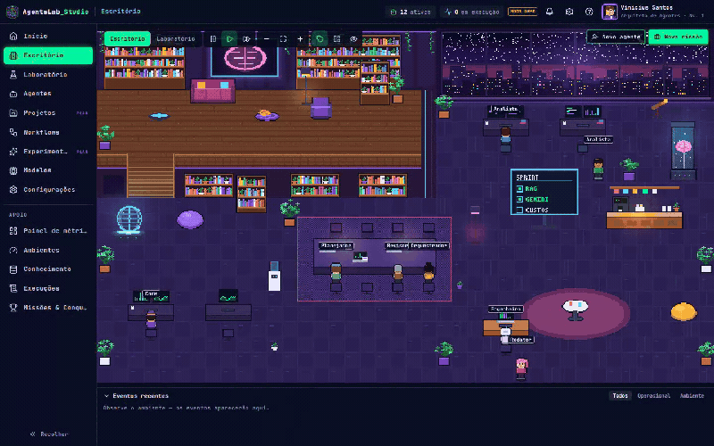
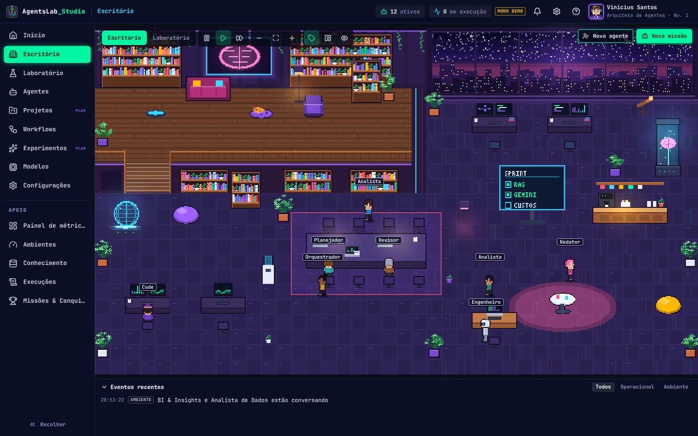
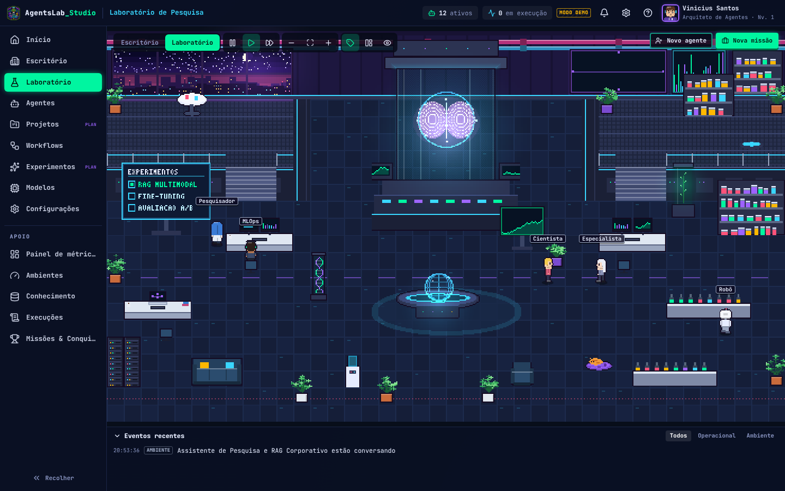
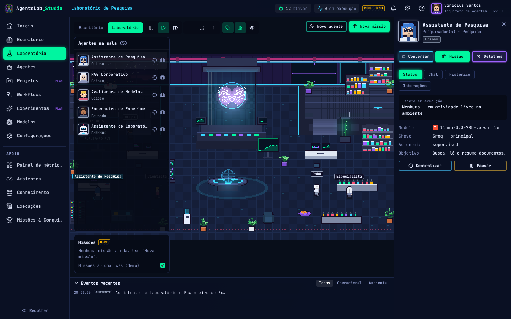
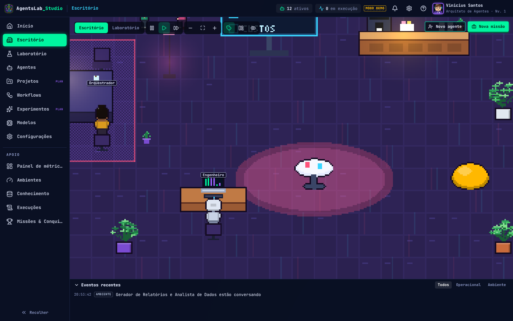

# AgentsLab_Studio

**Um pequeno mundo virtual de inteligências artificiais.** Agentes em pixel art 16-bit circulam por um escritório e um laboratório de pesquisa, trabalham em estações, tomam café, conversam, colaboram e executam missões — e cada personagem representa um agente configurável (modelo, chave de API, ferramentas, limites e personalidade).



| Escritório | Laboratório de Pesquisa |
|---|---|
|  |  |
|  |  |

> **v1.1 — Fase 1 (frontend) com modo demonstrativo.** Tudo que aparece com o selo **DEMO** é simulado localmente: nenhum LLM é chamado e nenhum custo real é gerado. O cofre de credenciais do backend já está implementado (ver “Chaves de API”).

## O que há de novo (redesign imersivo — “Environment First”)

- **Cenário como protagonista:** Escritório (mezanino, escadas, cafeteria, mesa colaborativa, janelas para a cidade) e Laboratório (núcleo neural com cérebro holográfico, passarelas, bancadas, mesa holográfica).
- **Agentes autônomos:** navegação A\* em tilemap com colisões, uso de objetos (computadores, café, estantes, sofás, equipamentos), conversas com balões, emotes, celebrações, visitas a outras áreas — tudo **local, sem consumir tokens**.
- **Personalidade configurável** (sociabilidade, criatividade, organização, curiosidade, colaboração, iniciativa) influenciando o comportamento.
- **Duas camadas separadas:** simulação ambiental × inteligência operacional. Tarefas têm prioridade: ao receber uma missão o agente larga o café e vai para a estação.
- **Interface enxuta:** barra superior compacta, menu lateral recolhível, painel contextual do agente (status, chat, histórico, interações), faixa de eventos recolhível, modo observador (tela cheia) e modo gerenciamento.
- **Câmera:** arrastar, zoom com a roda, duplo clique para seguir um agente.
- **Chaves de API por agente:** vários perfis por provedor (ex.: *Gemini · chave 1* e *Gemini · chave 2*), cada agente usa o seu.
- **GitHub Actions:** CI, vitrine visual (prints, vídeo e GIF gerados automaticamente) e release com bundle.

## Chaves de API (Gemini, Groq, OpenAI, Hugging Face, Ollama)

Sim — você cadastra as chaves **pelo próprio app** e pode ter **várias por provedor**, escolhendo qual cada agente usa:

1. **Modelos → Chaves (API)** → *Novo perfil de chave*: provedor + apelido (ex.: `Gemini · chave 2 (BI)`) + chave.
2. **Agent Studio → Inteligência → Chave de API (perfil)**: selecione o perfil para aquele agente (ou “Padrão do provedor”).

Segurança (por que a chave não fica no navegador):
- O frontend é um site estático público; qualquer valor nele (inclusive `VITE_*` e `localStorage`) pode ser lido. Por isso a chave é **enviada uma única vez ao backend** (`POST /api/v1/credentials`), que a **criptografa (Fernet)** com `AGENTSLAB_MASTER_KEY` e devolve só apelido + últimos 4 dígitos.
- No **modo demo** (sem backend) você cria os perfis e os associa aos agentes, mas o campo da chave fica desativado.
- Para usar chaves de verdade: suba `apps/api` (ver abaixo) e publique o frontend com `VITE_APP_MODE=real` e `VITE_API_BASE_URL=https://sua-api`.

## Instalação (Windows / PowerShell)

```powershell
cd C:\dev\AgentsLab_Studio\apps\web
copy .env.example .env
npm install
npm run dev          # http://localhost:5173
```

| Comando | O que faz |
|---|---|
| `npm run build` | typecheck + build de produção (`dist/`) |
| `npm test` | Vitest (A\*, motor ambiental, validações, stores, UI) |
| `npx playwright install chromium` e `npm run e2e` | testes de fluxo no navegador |
| `npm run media` | abre o app, interage e gera prints, vídeo (MP4) e GIF em `docs/media` (requer ffmpeg para GIF/MP4) |
| `npm run assets` | regenera sprites, mapas e tilemaps (`pip install pillow`) |

### Backend (cofre de credenciais + estrutura da API)

```powershell
cd C:\dev\AgentsLab_Studio\apps\api
python -m venv .venv; .venv\Scripts\activate
pip install -r requirements.txt
copy .env.example .env   # preencha AGENTSLAB_MASTER_KEY (comando de geração no arquivo)
uvicorn app.main:app --reload --port 8000
pytest
```

## Publicar no GitHub

```powershell
cd C:\dev\AgentsLab_Studio
powershell -ExecutionPolicy Bypass -File .\scripts\publicar-github.ps1
```

O script inicializa o Git, cria a branch `main`, aponta para `https://github.com/ViniciusKanh/AgentsLab_Studio.git` e faz o push (requer login no GitHub). Arquivos `.env` são ignorados.

### GitHub Actions (`.github/workflows`)

| Workflow | Quando | Resultado |
|---|---|---|
| **CI** (`ci.yml`) | push/PR | build, Vitest, Playwright (E2E) e pytest; artefatos `agentslab-web-dist` e `e2e-results` |
| **Showcase** (`showcase.yml`) | push na `main` (UI/assets) ou manual | abre o app no Chromium, interage, tira prints, grava vídeo, gera GIF/MP4; artefato `agentslab-media` e commit automático em `docs/media` (README sempre atualizado) |
| **Release** (`release.yml`) | tag `v*` (ex.: `git tag v1.1.0 && git push --tags`) | release com `agentslab-web-<tag>.zip` (site estático pronto) e `agentslab-api-<tag>.tar.gz` |

## Deploy do frontend

**Cloudflare Pages** ou **Vercel**: diretório raiz `apps/web`, build `npm run build`, saída `dist`. A Vercel usa `apps/web/vercel.json` (fallback SPA); o Cloudflare Pages faz o fallback nativamente. Variáveis: `VITE_APP_NAME`, `VITE_APP_MODE=demo|real`, `VITE_API_BASE_URL` (somente a URL pública da API — nunca segredos).

## Estrutura

```
apps/web/src
  world/            motor do mundo virtual (sem Phaser): mapas, A*, AmbientWorld, personalidade, diálogos, barramento de eventos
  world/render/     Phaser (WorldScene), camada DOM de rótulos/balões, host React (WorldCanvas)
  features/world/   tela imersiva: toolbar, painel contextual, faixa de eventos, gerenciamento, missões
  features/*        Agentes, Agent Studio, Workflows, Modelos (chaves), Painel de métricas, etc.
  simulation/       motor operacional DEMO (mesmo contrato de eventos do backend)
  stores/           Zustand: lab, simulação operacional, mundo (UI), missões, chat, gamificação
apps/api            FastAPI: /health, cofre de credenciais, rotas planejadas (501)
tools/pixelart      gerador procedural: personagens (27 quadros), mapas 40×23, atlas de props, tilemap de navegação
.github/workflows   CI, Showcase (mídia) e Release
docs/               arquitetura, design system, telas, modelo de agentes, roadmap, mídia
```

Documentação: [Arquitetura](docs/ARCHITECTURE.md) · [Design System](docs/DESIGN_SYSTEM.md) · [Telas](docs/SCREENS.md) · [Agentes](docs/AGENT_MODEL.md) · [Roadmap](docs/ROADMAP.md) · [CLAUDE.md](CLAUDE.md)
